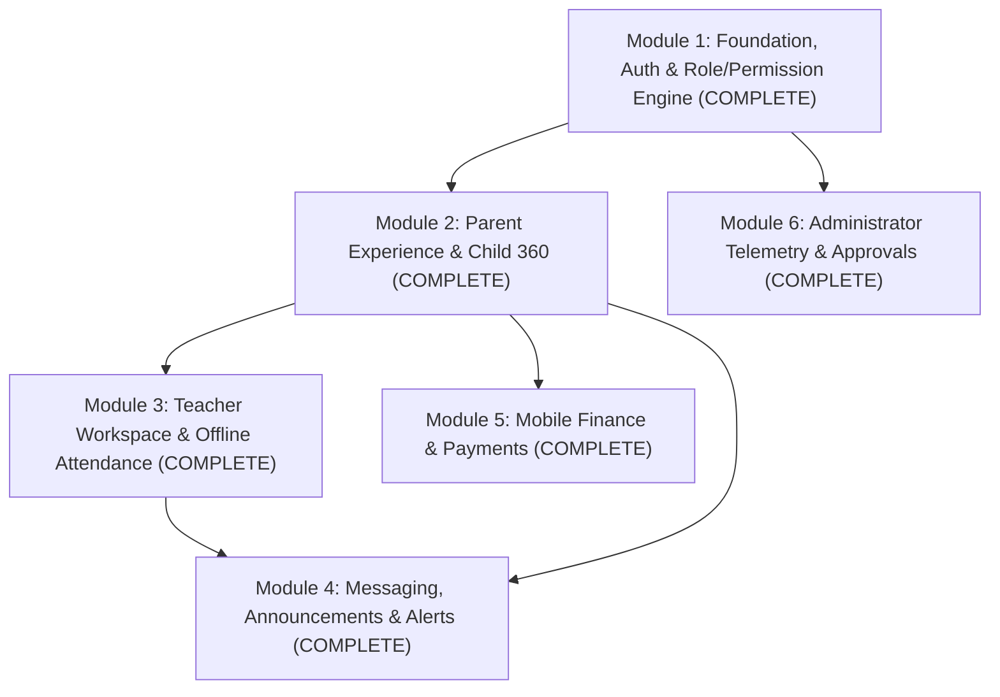

# NextGen School OS · Mobile Implementation Roadmap

**Architecture:** Flutter (Dart 3.5+) + Flutter Riverpod (State Management) + Dio (Networking & Sanctum Interceptors) + Hive (Offline-First Local Cache) + Flutter Secure Storage (Encrypted Tokens & Credentials).

Target Audience:
- **Parents & Guardians** (Primary Mobile Consumer)
- **Teachers & Classroom Staff** (Offline Attendance & Marks Entry)
- **School Administrators & Directors** (Executive Telemetry & Emergency Broadcasts)
- **Learners / Students** (Timetable, Homework, Published Results)

---

## Module Breakdown & Implementation Phases

---

### Module 1: Foundation, Authentication, Role & Permission Engine (Phase 1 - COMPLETE)
> **Goal:** Secure multi-role authentication, token persistence, offline-ready network client, and dynamic role/permission router.

- [x] **Project Structure & Clean Architecture**:
  - `core/` (network, storage, theme, constants, router, error handling)
  - `features/auth/` (models, state, repository, screens)
  - `features/navigation/` (adaptive role-based navigation shells)
  - `shared/` (common UI widgets, badges, buttons, cards)
- [x] **Storage & Networking Infrastructure**:
  - `SecureStorageService`: Encrypted storage for Sanctum Bearer tokens and login credentials.
  - `ApiClient`: Dio singleton with logging, automatic Sanctum token injection, base URL switching, and 401 unauthenticated interceptor.
  - `HiveInitializer`: Setup Hive local boxes for offline caching.
- [x] **Authentication Engine**:
  - Login by Email or Phone number + Password (supporting backend `login` or `email` fields).
  - Validation against backend statuses: `active`, `locked` (too many failed attempts), `deactivated`.
  - Guardian verification check handling.
  - Auto-login / session bootstrap on app startup.
  - Logout with token revocation.
- [x] **Role & Permission Engine (RBAC)**:
  - Strongly typed `UserModel`, `SchoolModel`, `Role`, and `Permission` parsing.
  - Capability methods: `hasRole(Role)`, `hasAnyRole(List<Role>)`, `hasPermission(String)`.
  - **Adaptive Home Router**:
    - `parent` ➔ Parent Home Portal
    - `teacher` ➔ Teacher Workspace
    - `school_admin` / `school_director` ➔ Administrator Dashboard
    - Multi-role switcher for staff who are also parents.
- [x] **UI & Design System**:
  - Material 3 theme matching NextGen Web palette (Indigo `#4338CA`, Slate darks, vibrant emerald/amber status accents).
  - Clean login screen, password visibility toggles, loading states, and error alerts.
  - Role-adaptive App Drawer and Bottom Navigation Bar.

---

### Module 2: Parent Portal & Child 360 Experience (Phase 2 - COMPLETE)
> **Goal:** Enable guardians to effortlessly track and support their children's education on mobile.

- [x] **Multi-Child Switcher (`ChildSwitcherBar`)**:
  - Horizontal animated ward carousel for households with multiple enrolled children.
  - Fast selection state persisted via Riverpod (`selectedChildIndexProvider`).
- [x] **Child 360 Pulse Dashboard (`Child360Card`)**:
  - 3 Core Metrics: Attendance Rate %, Fee Balance Due (MWK), Term Academic Average %.
  - Live morning roll call presence banner ("Marked present today in Form 3").
  - Merit & Conduct points overview (merits vs infractions).
- [x] **Attendance Module (`ChildAttendanceScreen`)**:
  - Term presence rate card with color-coded circular badges.
  - Multi-status filter tabs: All, Present, Late, Absent, Excused.
  - Chronological roll-call timeline with session types and teacher notes.
- [x] **Academics Module (`ChildAcademicsScreen`)**:
  - Overall Term Average banner with letter grade mapping.
  - Enrolled subjects list with individual progress meters, percentage marks, and teacher remarks.
  - Continuous assessment item breakdown (quizzes, tests, midterm exams).
- [x] **Fees & Statement Module (`ChildFeesScreen`)**:
  - Outstanding balance alert card (Clear / Overdue indicator).
  - Itemized Invoices accordion (tuition, transport, uniform, laboratory fees).
  - Payment Receipts ledger (Airtel Money, Mpamba, bank deposits).
  - Mobile Money payment CTA button.
- [x] **Timetable Module (`ChildTimetableScreen`)**:
  - Monday-to-Friday day selector.
  - Period schedule cards showing times, subjects, classrooms, and teacher names.
- [x] **Backend REST API Integration**:
  - Dedicated `ParentPortalApiController` handling `/api/v1/portal/children`, `attendance`, `academics`, `fees`, and `timetable` with guardian tenancy authorization.

---

### Module 3: Teacher Workspace & Offline Attendance (Phase 3 - COMPLETE)
> **Goal:** High-speed, offline-tolerant daily classroom operations for teachers.

- [x] **Offline-First Roll Call Register (`DailyRollCallScreen`)**:
  - Class group and stream student roster with fast search.
  - One-tap "Mark All Present" action for instant morning check-ins.
  - 4-way individual toggle buttons: **P** (Present), **L** (Late), **A** (Absent), **E** (Excused) with notes.
  - Real-time attendance tally bar (Present, Late, Absent, Excused counters).
- [x] **Hive Offline Synchronization Queue**:
  - Automatically commits roll-call records locally to Hive storage first.
  - Automatically attempts direct sync if online.
  - Queues unsynced roll-calls when offline with pending count indicator on the teacher home screen.
  - One-tap "Sync Now" batch runner in `TeacherHomeScreen`.
- [x] **Continuous Assessment Marks Entry (`TeacherMarksScreen`)**:
  - Lists assessments with weights and maximum scores.
  - Numeric score input with automatic Grade (A, B, C, D) computation and comment generation.
- [x] **Teacher Schedule (`TeacherTimetableScreen`)**:
  - Weekday class schedule viewer with period times, classrooms, and subject details.
- [x] **Backend REST API Integration**:
  - `TeacherWorkspaceApiController` handling `/api/v1/teacher/classes`, `/classes/{id}/students`, `/attendance/sync`, `/assessments`, `/assessments/{id}/marks`, and `/timetable`.
  - Dispatches `AbsenteeGuardianNotifier` background job to automatically notify guardians when students are marked absent.

---

### Module 4: Communication, Messaging & Notifications (Phase 4 - COMPLETE)
> **Goal:** Real-time engagement between school administration, educators, and households.

- [x] **School Announcements Feed (`AnnouncementsScreen`)**:
  - Segmented notices (All School, Form 1-4, Staff).
  - Priority badges (Urgent, Event, Information).
  - Hive offline cache fallback.
- [x] **Teacher-Parent Messaging (`MessagesInboxScreen`, `ComposeMessageScreen`)**:
  - Direct 1-on-1 thread communication between guardians and class teachers.
  - Contact selector preloaded from enrolled ward's class teachers.
  - Message status (read/unread) tracking with mark-as-read API.
- [x] **School Calendar & Events (`SchoolCalendarScreen`)**:
  - Term dates, holidays, midterms, parent-teacher meetings, sports days.
  - Filterable by type (Academic, Holiday, Meeting, Sports).
- [x] **Backend REST API Integration**:
  - `CommunicationApiController` handling `/api/v1/communication/announcements`, `events`, `messages`, `contacts`, and `messages/{id}/read`.

---

### Module 5: Mobile Finance & In-App Payments (Phase 5 - COMPLETE)
> **Goal:** Frictionless fee settlement directly from the mobile app via Malawian mobile money operators.

- [x] **Mobile Money Gateway Checkout (`MobileMoneyPaymentScreen`)**:
  - Direct operator selection for **Airtel Money** (Red theme `#E11900`, `099...` prefix hint) and **TNM Mpamba** (Green theme `#059669`, `088...` prefix hint).
  - Quick amount presets: Full Due, 50% Term Deposit, Custom Amount.
  - Form validation with Malawian phone format checking.
  - Interactive USSD PIN push guidance.
  - Immediate optimistic invalidation of guardian fee ledger.
- [x] **Official Digital Receipt Voucher (`DigitalReceiptScreen`)**:
  - Official school payment voucher layout with school crest, reference numbers, learner metadata, and fee breakdown.
  - Cryptographic verification seal with simulated tamper-proof QR code.
  - Save to PDF / Share receipt capabilities.
- [x] **Parent Portal Ledger Integration**:
  - Directly launched from `ChildFeesScreen` "Pay via Airtel Money / TNM Mpamba" or individual invoice action buttons.
  - Payment receipt history items directly open the verifiable `DigitalReceiptScreen`.
- [x] **Backend REST API Integration**:
  - `MobileFinanceApiController` handling `/api/v1/finance/pay-mobile-money`, `/api/v1/finance/receipt/{reference}`, and `/api/v1/finance/history`.
  - Automatic invoice balance decrement and status transitions (`partial` or `paid`).

---

### Module 6: School Leadership & Telemetry (Phase 6 - COMPLETE)
> **Goal:** Mobile executive cockpit for Headteachers, Directors, and Administrators.

- [x] **Executive Telemetry Cockpit (`AdminHomeScreen`)**:
  - Real-time KPI grid: Enrolled Learners (with % capacity utilization), Today's Attendance % (with Present, Absent, Late breakdown), Term Fees Collection % in MWK, and Staff On-Duty count.
  - Tenancy-scoped auto-refresh with pull-to-refresh.
- [x] **Pending Institutional Approvals (`PendingApprovalsScreen`)**:
  - Multi-tab approval queue for Staff Leave Requests and Student Transfers.
  - One-tap "Approve" (green) and "Decline" (red) with optional administrative remarks dialog.
  - Instant live count badge and alert banner on the executive dashboard.
- [x] **Emergency School Broadcast (`EmergencyBroadcastScreen`)**:
  - High-priority alert dispatcher with target audience scoping (All Households, Specific Forms 1-4, Staff).
  - Delivery channel toggles (Mobile App Push, SMS Gateway).
  - Leadership verification authorization safeguard.
  - Post-dispatch receipt summary dialog displaying total recipients reached.
- [x] **Backend REST API Integration**:
  - `AdminTelemetryApiController` handling `/api/v1/admin/telemetry`, `/api/v1/admin/approvals`, `/api/v1/admin/approvals/{type}/{id}`, and `/api/v1/admin/emergency-broadcast`.

---

## Development Milestones & Definition of Done

Each module is accepted when:
1. State management is covered with Riverpod providers.
2. Models parse backend JSON contracts safely with fallback values.
3. Network failures degrade gracefully (showing offline indicators or cached data).
4. Tests / analyzer pass with zero errors (`flutter analyze`).

